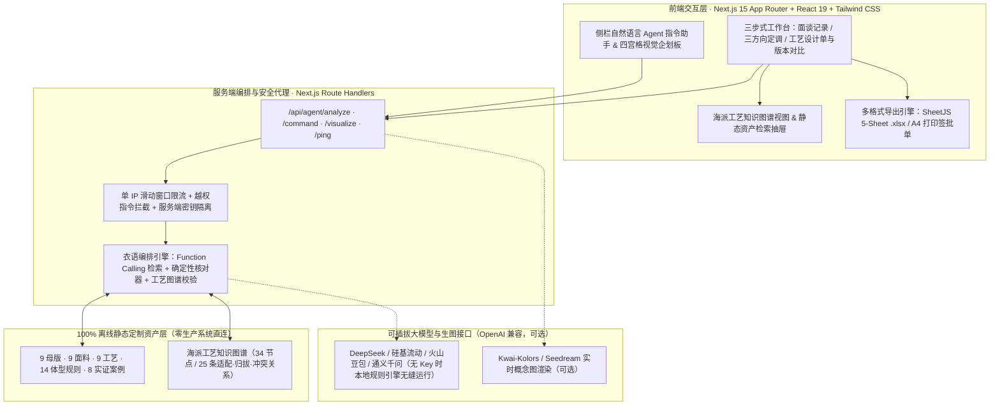

# 衣语 TailorMind · 海派定制 AI 企划助手

**TailorMind — Decode the Intent, Then Tailor**

> **DOAI 2026 全球创客大会 · FDE-03（上服集团 / 上海服装集团）参赛开源原型**  
> *「老师傅量体裁衣，靠的是几十年经验。我们做的，是先把客户的『意』听懂。」*

---

## 一、项目定位

**衣语（TailorMind）** 面向上海服装集团的定制业务专员、职业服方案设计师与企划人员，用于辅助**海派高级私定**与**团体职业服定制**的前端面谈记录、需求解构、方案定调、工艺核验与台账归档。

围绕 **「AI 听意，匠人量体」** 的分工边界：

1. **先保证「满足需求可核对」**：将客户口语化诉求拆解为逐条硬/软需求与上服标准八项设计语言，通过「体型/场合 → 裁剪结构」规则库与**海派工艺知识图谱**实时拦截结构冲突与洗护禁忌，并由确定性核对器逐条校验是否遗漏。
2. **再通过多方向比选逼近「好看」**：针对信息缺失或需求冲突主动生成可点击追问建议；在满足全部硬性要求的前提下，遵循海派克制美学给出 **A 稳妥经典 / B 单点提亮 / C 现代利落** 三个方向，帮助顾问在打样前与客户现场定调。
3. **严守人工终审与数据静态化红线**：原型 100% 使用集团存量模拟静态数据，不接入生产 ERP/MES/CRM 或真实业务 API；净体量体、实物色卡签样、富怡/ET CAD 纸样定稿、商务核价签约与排产下单全部由业务人员与制版师人工完成。

使用方式：**顾问陪同顾客完成一次线上对话**。系统边听边拆需求、边追问边出方向，当场确认效果图与工艺单，把需求确认从多次到店压缩为一次。

### 赛题要求对照

| 赛题要求 | 本项目实现 | 状态 |
| :--- | :--- | :--- |
| 对话 Agent 主动追问 | 按缺口和冲突生成可点选追问（如“老上海味道”想体现在哪一处、“老气”更接近哪一种），每轮最多 3 问 | 已实现 |
| 口语描述 → 结构化需求单 | 逐条需求（原话出处、责任人、落实状态）+ 上服八项设计语言；“老上海味道但别老气”拆成两条互补需求 | 已实现 |
| 参考图 → 结构化需求单 | 未配置视觉模型时追问“参考图最喜欢哪一处”；配置后由视觉模型识别领型、颜色、面料等并入需求单 | 已实现（视觉模型可选） |
| 海派工艺知识图谱约束校验 | 6 层 34 节点（领型、盘扣、面料、归拔等），冲突关系实时拦截做不出来的设计 | 已实现 |
| 风格 LoRA + ControlNet 实时效果图 | 当前以母版实物图做图生图结构约束；已预留风格 LoRA + ControlNet 服务接口，接入推理服务即可启用 | 部分实现（接口已预留） |
| 输出直达版房的工艺单 | 版房工艺包（放量、面辅料清单、归拔整烫、打样必检）+ 5-Sheet 台账 + A4 签批单 | 已实现 |

---

## 二、核心功能模块

### 1. 三步式海派定制工作台
- **Step 1 · 面谈记录与需求解构**：支持文字录入、现场语音听写与参考照片上传（参考图通过追问或视觉模型转成需求）；能把“老上海味道”这类风格词落到一处海派工艺点题；自动拆解逐条客户需求（含角色归属与「待制版师核准」标记）及上服标准八项设计语言，识别信息缺失与需求冲突，生成追问建议；内置确定性核对器（`verifier.ts`）实时检查未处理短句与落地状态。
- **Step 2 · 三方向定调与细部检视**：在同一组硬需求下输出 **A 稳妥 / B 亮点 / C 现代** 三套参考方向，可一键生成效果图（以该方向的母版实物图约束版型结构），支持领口、肩袖、门襟、下摆的局部细部检视；团装模式自动生成 **高管 / 顾问 / 迎宾** 三级同源岗位配置矩阵。
- **Step 3 · 工艺设计单与版房工艺包（Tech Pack）**：一键生成面向顾问与版房的纸质风工艺设计单与结构化版房工艺包（含关键部位放量基准、BOM 面辅料清单、归拔整烫工艺与打样必检项），支持方案**版本对比与一键回滚**。

### 2. 海派工艺知识图谱 & 集团静态资产库
- **海派工艺知识图谱（34 节点 / 25 条关系）**：覆盖「体征场合约束 → 版型母版 → 领型制式 → 海派面料 → 盘扣与装饰工艺 → 归拔与整烫工艺」六层关系网络，支持 `COMPATIBLE_WITH` 推荐、`REQUIRES_SHAPING` 归拔联动与 `CONFLICTS_WITH` 工艺禁忌实时拦截（如立领旗袍外搭禁用传统高立领、高频机洗团装禁用真丝宋锦）。
- **结构化静态资产库（`src/data/`）**：
  - **9 款**海派私定与团装母版（含富怡/ET 裁片与缝份规范）
  - **9 款**特色非遗与高抗皱团装面料（宋锦、香云纱、重磅真丝、Super 110s 羊毛呢等）
  - **9 项**海派经典与克制 VI 工艺（极细嵌条、马头墙撞色、如意免伤衣扣眼等）
  - **14 条**体型/场合裁剪结构规则（明确区分上服 6 案例实证规则与待制版师核准的通用规则）
  - **8 套**历史实证与标杆模拟案例（完整收录上服官方 6 案例及 15 张原图）

### 3. 自然语言指令助手（Agent Copilot）
- 侧栏内置上下文感知指令助手，支持用自然语言直接修改袖长、切换指定方向母版/面料/工艺、查询资产选配依据、更新需求核验状态并支持一键撤销。
- 内置合规拦截机制，对「代为签约、对外报价、收取定金、下达排产」等越权指令直接拒绝并引导人工流程。

### 4. 四宫格视觉企划板 & 5-Sheet 专题台账导出
- **视觉企划板**：复刻上服官方企划板四分镜（成衣正背 / 工艺微距 / 面料色卡 / 上身氛围），同步生成适配 **豆包即梦（中文）** 与 **Midjourney v6（英文）** 的标准化提示词包，支持一键复制及按需调用生图接口实时渲染。
- **客户档案与专题台账**：按客户自动归集多单历史与参考照，完整记录上服六步工作流与操作审计留痕；团装模式自动汇总号型分布与特体单量清单；一键导出 **5-Sheet `.xlsx` 专题台账** 及可打印 A4 设计签批单。

---

## 三、内置标杆演示场景

系统开箱即内置 3 套端到端模拟业务案例（覆盖私定与团装两大范式），并支持随时新建任意自定义客户面谈：

| 场景类型 | 标杆案例 | 核心痛点与检验亮点 |
| :--- | :--- | :--- |
| **海派高级私定** | **陈女士 · 婚礼旗袍外搭外套** | 酒红色、内搭旗袍避让、轻微驼背与手臂偏粗修饰、端庄不老气；完整触发追问与工艺图谱校验 |
| **海派高级私定** | **外滩国际文化论坛主旨演讲外套** | 脖子偏短怕卡脖（低立领 ≤ 2.6cm）、微有肚腩（H 型前腹放量）、抬手演讲与白玉兰暗纹融入 |
| **团体职业服企划** | **陆家嘴私行 35 人三级职业服** | 高管/顾问/迎宾三级同源配置、深海藏青+香槟金克制 VI、久坐抗皱跨年补单、30 套码 + 5 特体归档 |

---

## 四、技术架构



### 多智能体流水线

每轮面谈按固定顺序经过四个 Agent，界面上可展开查看每一步的输入、依据与结果：

| Agent | 职责 | 实现方式 |
| :--- | :--- | :--- |
| 对话解构 Agent | 拆需求、识别缺口与冲突、生成追问；参考图经视觉模型识别后并入原话 | 大模型 Function Calling 检索资产库；无 Key 时用本地规则引擎 |
| 工艺图谱校验 Agent | 按知识图谱过滤做不出来的领型、面料、工艺组合，并给出拦截依据 | 确定性图谱遍历，结果可复现 |
| 视觉企划 Agent | 编译三方向与四分镜提示词，调用生图接口出效果图 | 母版实物图约束生图；预留 LoRA + ControlNet 服务 |
| 版房工艺单 Agent | 汇总放量、面辅料、归拔整烫与打样必检项 | 确定性构建，直接对接版房 |

校验与工艺单两步刻意不用大模型，保证“做不出来的设计一定被拦下”，结果不随模型波动。

### 目录结构

```text
TailorMind/
├── src/
│   ├── app/
│   │   ├── page.tsx                    # 工作台主入口与状态编排
│   │   ├── layout.tsx / globals.css / workbench.css
│   │   └── api/agent/
│   │       ├── analyze/route.ts        # 需求解构、资产匹配与方案生成接口
│   │       ├── command/route.ts        # 自然语言修改/解释指令解析接口
│   │       ├── visualize/route.ts      # 四分镜实时生图代理接口
│   │       └── ping/route.ts           # 模型连通性校验接口
│   ├── components/
│   │   ├── screens/                    # 三大核心业务屏（面谈/三方向/工艺设计单）
│   │   ├── workbench/                  # 工作台导航、客户档案、台账、资产库、知识图谱、设置页、版本对比
│   │   ├── modals/                     # 资产检视抽屉与成衣局部细部检视弹窗
│   │   └── studio/                     # 四宫格视觉企划板与提示词工作室
│   ├── data/                           # 纯静态资产知识库与工艺知识图谱
│   │   ├── kb-patterns.ts              # 9 款版型母版与 CAD 缝份放量规范
│   │   ├── kb-fabrics.ts               # 9 款海派与团装面料物性库
│   │   ├── kb-crafts.ts                # 9 项非遗与海派工艺库
│   │   ├── kb-body-rules.ts            # 14 条体型/场合裁剪结构规则
│   │   ├── kb-cases.ts                 # 8 套上服官方案例与团装标杆案例
│   │   ├── craft-knowledge-graph.ts    # 海派工艺知识图谱（34 节点 / 25 边）
│   │   └── demo-scenarios.ts           # 3 套开箱即用演示场景
│   └── lib/                            # Agent 编排引擎、核对器、图谱校验、工艺包构建与台账导出
├── public/
│   ├── cases/shangfu/                  # 上服官方 6 案例 15 张原图（成衣/企划板/CAD/白坯）
│   └── generated/                      # 标杆方案与面料色卡高清参考图
├── scripts/
│   └── p0-regression.mjs               # P0 核心需求拆解、换说法与上服 6 案例回归验收脚本
├── .env.example                        # 环境变量配置模板
└── package.json
```

---

## 五、快速开始

### 环境要求
- **Node.js >= 20**（内置 `fetch` 与 ESM Hooks）
- **npm >= 10**

### 1. 安装依赖与启动

```bash
# 克隆仓库
git clone https://github.com/xxxpixel-x/TailorMind.git
cd TailorMind

# 安装依赖
npm install

# 启动本地开发服务器
npm run dev
```

打开浏览器访问 **http://localhost:3000** 即可直接体验完整功能。

> **免密钥开箱体验**：未配置任何大模型 API Key 时，系统会自动运行内置的本地多智能体规则引擎、确定性需求核对器与海派工艺知识图谱校验器，所有工作流、资产检索与 5-Sheet Excel 导出均可完整离线运行。

### 2. 配置大模型与生图接口（可选）

支持两种方式接入 OpenAI 兼容接口（内置 **DeepSeek 官方 / 硅基流动 / 火山引擎豆包 / 通义千问** 预设）：

- **方式 A（推荐 · 服务端环境变量）**：复制 `.env.example` 为 `.env.local` 并填入密钥（前端不暴露密钥，内置基于 IP 的滑动窗口限流）：

| 环境变量 | 说明 | 默认值 |
| :--- | :--- | :--- |
| `LIANGYI_LLM_BASE_URL` | 文本大模型 API Base URL（OpenAI 兼容） | `https://api.deepseek.com/v1` |
| `LIANGYI_LLM_API_KEY` | 文本大模型 API Key（也兼容 `DEEPSEEK_API_KEY`） | 空（自动降级本地引擎） |
| `LIANGYI_LLM_MODEL` | 文本大模型名称 | `deepseek-chat` |
| `LIANGYI_IMAGE_BASE_URL` | 可选：实时生图接口 Base URL | `https://api.siliconflow.cn/v1` |
| `LIANGYI_IMAGE_API_KEY` | 可选：生图接口 API Key | 空（展示预置高清样图） |
| `LIANGYI_IMAGE_MODEL` | 可选：生图模型名称 | `Kwai-Kolors/Kolors` |
| `LIANGYI_VISION_MODEL` | 可选：参考图视觉模型名称，填写后启用参考图识别（如 `Qwen/Qwen2.5-VL-72B-Instruct`） | 空（改用参考图追问） |
| `LIANGYI_VISION_BASE_URL` | 可选：视觉模型 Base URL | 同页面文本模型 |
| `LIANGYI_VISION_API_KEY` | 可选：视觉模型 API Key | 同页面文本模型 |
| `LIANGYI_STYLE_SERVICE_URL` | 预留：风格 LoRA + ControlNet 推理服务地址（如自建 ComfyUI 封装），见下方接口约定 | 空（使用通用生图接口） |
| `LIANGYI_STYLE_LORA` | 预留：海派风格 LoRA 标识 | `haipai-v1` |
| `LIANGYI_CONTROL_TYPE` | 预留：ControlNet 控制类型 | `lineart` |
| `LIANGYI_RATE_LIMIT_PER_MIN` | 公网部署单 IP 每分钟推理上限 | `6` |
| `LIANGYI_RATE_LIMIT_PER_DAY` | 公网部署单 IP 每日推理上限 | `30` |

- **方式 B（页面内即时配置）**：进入工作台左下角 **「设置 → 模型接口」**，选择预设并填入 Key 后点击「测试连接」即可启用（配置仅保存在本地浏览器 `localStorage`）。

**风格 LoRA + ControlNet 服务接口约定（预留）**：配置 `LIANGYI_STYLE_SERVICE_URL` 后，生图请求优先发往该地址，服务不可用时自动回落到通用生图接口。

```jsonc
// POST LIANGYI_STYLE_SERVICE_URL
{
  "prompt": "方向提示词",
  "negativePrompt": "反向提示词",
  "loraId": "haipai-v1",            // 用上服历年成衣照训练的海派风格 LoRA
  "controlImage": "data:image/...", // 该方向的母版实物图，作为 ControlNet 控制图
  "controlType": "lineart"
}
// 返回 { "imageUrl": "https://... 或 data:image/..." }
```

### 3. 生产构建与自动化回归验收

```bash
# 运行 P0 端到端回归测试（覆盖婚礼旗袍外搭、换说法、无色追问、上服 6 官方案例及 35 人团装）
node scripts/p0-regression.mjs

# 生产环境构建与启动
npm run build
npm run start
```

---

## 六、Agent 能力边界与合规声明

| 定制业务环节 | 衣语 TailorMind（AI 辅助上限） | 必须由人工终审执行的职责 | 责任主体 |
| :--- | :--- | :--- | :--- |
| **需求解构与追问** | 输出需求对照清单、八项设计语言草稿与冲突追问建议 | 现场核实客户体态、生活习惯并确认最终需求 | 定制业务专员 |
| **面料与工艺推荐** | 基于静态库与工艺图谱推荐资产编码并拦截结构/洗护冲突 | 出示实物色卡与样布，自然光下签封色样 | 定制业务专员 + 客户 |
| **视觉企划与提示词** | 生成四分镜标准化提示词与概念参考图 | 审核结构可缝制性并绘制正式平面款式线稿 | 服装方案设计师 |
| **量体与 CAD 制版** | 提示母版编号、体征放量方向与归拔重点 | 净体软尺量体、富怡/ET CAD 工业制版、放码与样衣试穿 | 资深量体师 / 制版师 |
| **核价、签约与排产** | 仅保留台账占位字段，拒绝代签/报价/排产指令 | 核算工料成本、对外商务报价、合同签署与下达排产 | 商务主管 / 业务负责人 |

> 系统内置数据均为集团存量模拟静态数据，零生产系统直连；Web 工作台「设置 → 能力边界」及导出的 `.xlsx` 台账、A4 签批单均内置人工终审边界声明。
